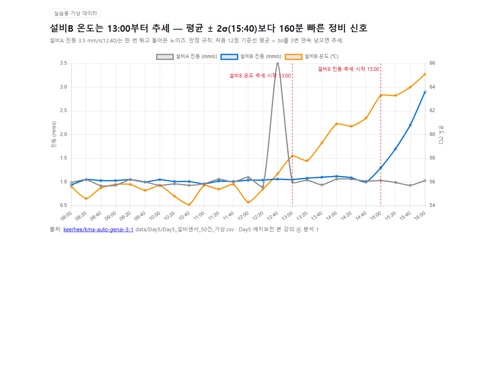

# 예지보전 실습판: 노이즈인가, 추세인가 — learn-pdm-lite-hgd

설비 진동·온도 기록에서 한 번 튄 값(노이즈)과 꾸준한 상승(추세)을 가려 정비 신호가 시작된 시각을 찾고, 그래프 한 장으로 공개하는 10분 실습. 수업은 Claude Code 스킬 `/learn-pdm-lite-hgd`가 진행한다 (Skills as Curriculum). 이 강의는 hgd가 course-forge로 직접 만들었다.

- **결과 대시보드**: https://kayyim0000-eng.github.io/learn-pdm-lite-hgd/
- 처음이면 [GUIDE.md](GUIDE.md)부터. 기본 환경은 Claude 데스크톱 앱(Code 탭). VS Code는 GUIDE 부록 B



## 설치 — 한 줄

Claude Code 입력칸에 붙여 넣는다.

```
npx skills add kayyim0000-eng/learn-pdm-lite-hgd --agent claude-code --global --yes 를 실행해 줘
```

새 세션에서 `/learn-pdm-lite-hgd`를 입력하면 수업이 시작된다. zip을 받았다면 GUIDE.md 2단계대로 설치한다.

## 블록

| Block | 주제 | 끝나면 생기는 것 |
|---|---|---|
| 0 | 준비 — 작업 폴더·데이터 | env_check.txt |
| 1 | 노이즈 vs 추세 (퀴즈 1문항) | 판정표 · 그래프 한 장 — 설비B 온도 13:00 추세 시작 |
| 2 | 공개 | GitHub Pages 주소 · 공유 메시지 |

## 수업 방식

| 구분 | 내용 |
|---|---|
| 목표 — AI Native | AI에게 맡기는 것이 기본인 방식으로 일한다 |
| 방법 — Skills as Curriculum | 스킬이 블록마다 설명 → 실습 → STOP → 확인·퀴즈를 진행한다 |
| 형식 — 자율학습 | 강사 없이 자기 속도로, 퀴즈로 스스로 점검한다 |

## 원본 강의와 데이터 출처

| 자료 | 출처 | 구분 |
|---|---|---|
| 강의 흐름 · 용어 · 실습과제 2 · 모범답안 | [keerhee/kma-auto-genai-3-1](https://github.com/keerhee/kma-auto-genai-3-1) `Day5_예지보전/` 본 강의 ④ 분석 1 | 원본 강의 |
| `Day5_설비센서_50건_가상.csv` | 같은 저장소 `data/Day5/` | 실습용 가상 데이터 |

## 개정 이력

| 날짜 | 바뀐 점 |
|---|---|
| 2026-10-31 | 첫 판 (블록 3개, 10분) |

## 만든 방법

- `/course-forge`로 만들었다. 제작 기록(원본 요약·커리큘럼·검수 결과)은 `forge/`에 있다.
- 출처: 원본 강의 저장소 https://github.com/keerhee/kma-auto-genai-3-1
